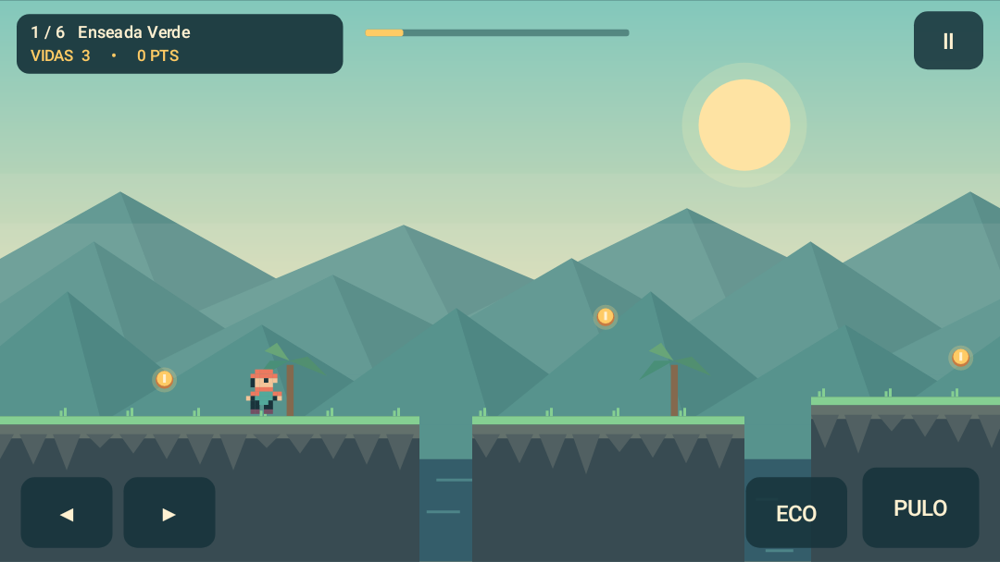

# Mini Platform Adventure — Trilha dos Faróis

Jogo de plataforma 2D para Android, desenvolvido em Java para a disciplina de Programação III da UEMG Passos. Em uma expedição por seis ilhas, o jogador precisa alcançar cada farol, saltar sobre os vãos e decidir quando usar o eco para atravessar uma patrulha.

**Discente** — Mateus Carvalho Rodrigues da Silva  
**Docente** — Eduardo Henrique Marques Ferreira  
**Curso** — Sistemas de Informação, 6º período • UEMG, Unidade Passos • 2026/2



## Jogar

[Baixar o APK de demonstração](https://github.com/MateusMcR/mini-platform-adventure/raw/refs/heads/main/downloads/Trilha-dos-Farois.apk). Requer Android 7.0 ou superior. Abra o aplicativo em paisagem e toque em **Iniciar expedição**. A campanha inteira funciona offline.

| Ação | No celular | No teclado |
| --- | --- | --- |
| Correr | Segurar ◀ ou ▶ | ← / → ou A / D |
| Pular | Tocar em PULO enquanto corre | Espaço ou ↑ |
| Emitir eco | Tocar em ECO | E |
| Pausar | Tocar em Ⅱ | P |

Você começa com **3 vidas**. Uma queda ou colisão lateral com um guarda ativo consome uma vida. A bandeira no meio da fase registra o ponto de retorno. Moedas valem **25 pontos**, derrotar um guarda saltando sobre ele vale **50**, e alcançar o farol vale **150**. Um guarda atingido pelo eco deixa o jogador passar durante dois segundos. O eco recarrega em 2,6 segundos.

Ao sair para o acampamento, a campanha conserva fase, pontos, vidas, moedas coletadas, guardas derrotados e bandeira. Ao continuar, você volta à bandeira ativada ou ao início da fase. O ranking local mantém as dez melhores campanhas encerradas, inclusive tentativas que chegaram ao fim das vidas.

## As seis fases

| Fase | Ilhas de apoio | Guardas | Travessia |
| --- | ---: | ---: | --- |
| Enseada Verde | 6 | 1 | Primeiros saltos e apresentação da bandeira. |
| Falésias de Cobre | 7 | 2 | Subidas sucessivas e o primeiro salto sobre uma patrulha. |
| Bosque da Névoa | 8 | 3 | Plataformas mais estreitas e aproximações para usar o eco. |
| Salinas de Vidro | 9 | 4 | Quatro patrulhas distribuídas pelos degraus de sal. |
| Caldeira Rubra | 10 | 5 | Alternância de alturas e patrulhas em ilhas vizinhas. |
| Farol das Estrelas | 11 | 6 | Maiores vãos da campanha e guardas com patrulha mais rápida. |

## Recursos do equipamento

As opções ficam no **Caderno de campo**. Os controles de toque permanecem acessíveis quando um recurso está indisponível.

| Recurso | Como demonstrar | Implementação |
| --- | --- | --- |
| Giroscópio | Ligue **Gesto de pulo**, entre em uma fase e gire brevemente o celular no plano da tela. | SensorManager e TYPE_GYROSCOPE usam a velocidade angular do eixo Z para pedir o salto. |
| Câmera | Toque em **Fotografar explorador**, tire a foto e confirme. O retrato aparece no caderno. | Uma Intent abre o aplicativo de câmera. A miniatura retornada é salva no armazenamento privado. |
| Microfone | Ligue **Eco por som**, permita o uso, aproxime-se de um guarda e bata uma palma. O anel luminoso mostra o alcance. | AudioRecord calcula a energia do som em memória. A captura funciona durante a partida e para na pausa. |
| GPS | Toque em **Obter selo por localização** e permita localização precisa. Em local aberto, aguarde o selo com os hemisférios e a distância até Passos. | LocationManager prioriza GPS com permissão precisa. Se houver apenas localização aproximada ou se o GPS estiver desligado, tenta o provedor de rede. A posição é usada localmente. |
| Internet | Toque em **Atualizar clima pela internet**. Confira temperatura, condição e horário da medição. Com precipitação, aparecem partículas na fase. | HTTPS e JSON, com consulta à [Open-Meteo](https://open-meteo.com/) usando coordenadas fixas de Passos. A última resposta fica disponível offline. |

## Relação com as aulas

- **Arquitetura e anatomia da aplicação** — Activity, interface XML, recursos em res/, AndroidManifest e Gradle.
- **SimplePaint** — a mesma ideia de uma View que recebe toque e desenha com Canvas, Paint e Path é usada para plataformas, personagens, moedas e comandos multitoque.
- **Cadastro de produtos** — SQLiteOpenHelper organiza a campanha salva e o ranking. A gravação do resultado e a exclusão da campanha encerrada compartilham uma transação.
- **Câmera e Smart Walk** — Intent de captura, permissões em tempo de execução, localização, sensores e liberação de recursos no ciclo de vida.
- **Eventos e infraestrutura móvel** — listeners, processamento do som e da rede fora da interface, resposta a indisponibilidade e retomada após pausa.

## Abrir no Android Studio

1. Clone este repositório e abra a pasta que contém **settings.gradle** no Android Studio.
2. Selecione **JDK 17** como Gradle JDK e instale a plataforma **Android SDK 35** pelo SDK Manager.
3. Aguarde a sincronização. Selecione o módulo **app** e execute em um celular ou emulador com Android 7.0+.
4. Para demonstrar giroscópio, microfone, câmera e GPS juntos, use um aparelho que disponha desses recursos.

No Windows, execute na raiz:

```powershell
.\gradlew.bat testDebugUnitTest assembleDebug
```

No Linux ou macOS:

```sh
./gradlew testDebugUnitTest assembleDebug
```

O APK gerado fica em `app/build/outputs/apk/debug/app-debug.apk`. A primeira compilação precisa de internet para obter as dependências.

## Organização do código

| Arquivo | Responsabilidade |
| --- | --- |
| Stage.java | Mapas, cores, patrulhas e posições das bandeiras e faróis. |
| Game.java | Física em passos fixos, colisões, vidas e regras de pontuação. Independente do Android. |
| GameView.java | Loop de desenho, câmera lateral, multitoque, teclado e HUD. |
| Scenery.java e CoverView.java | Cenários, sprites, animação do eco e ilustração da capa. |
| Equipment.java | Giroscópio, leitura de amplitude, localização e consulta meteorológica. |
| FieldStore.java | Persistência em SQLite e ranking das campanhas. |
| MainActivity.java | Acampamento, caderno, câmera, efeitos sonoros e ciclo de vida. |

Os testes JUnit simulam a campanha usando corrida, salto e eco como entradas, incluindo o percurso inteiro das seis fases. Os testes Android com Robolectric exercitam a Activity, a pausa, os dados locais, o retorno da câmera, a recusa do microfone e a renderização com Canvas. A calibração dos gestos e da palma depende do hardware do celular.
